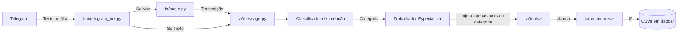
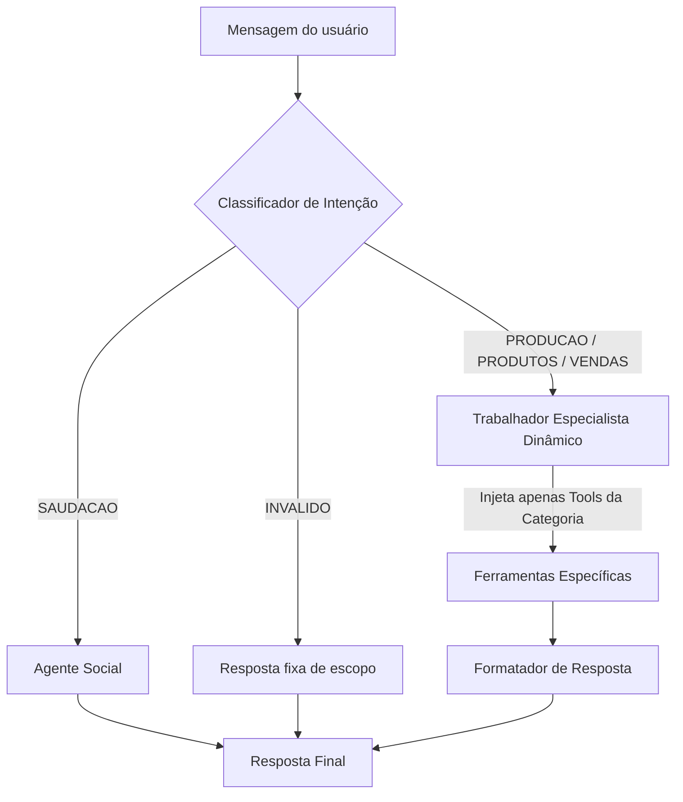

# 🧠 Arquitetura — MIA

## Sumário
- [Visão geral das camadas](#visao-geral)
- [1. Utilitários Globais (`ia/tools/utils.py`)](#utils)
- [2. Motor de Dados: Procedures (`procedures/`)](#procedures)
- [3. Ferramentas da IA: Tools e Registry (`tools/`)](#tools)
- [4. Agentes de IA e Fluxo de Mensagens](#agentes)
<!-- - [Nota de manutenção](#manutencao) -->

---

## Visão geral das camadas <a id="visao-geral"></a>

O backend separa estritamente as responsabilidades, com suporte avançado a processamento de voz e roteamento dinâmico de contexto para otimizar o uso da GPU local:

- **Procedures** → motor matemático e de dados, com Pandas. Não sabe nada sobre IA.
- **Tools e Registry** → interfaces semânticas categorizadas que chamam as Procedures.
- **Áudio** → conversão e transcrição de áudio via FFmpeg e Google STT, com síntese via Edge TTS.



---

## 1. Utilitários Globais (`ia/tools/utils.py`) <a id="utils"></a>

Funções de apoio usadas pelas *tools* antes de acionar as *procedures*.

| Função | Assinatura | O que faz |
| --- | --- | --- |
| `converter_data_relativa` | `converter_data_relativa(data_alvo: str) -> str` | Converte hoje/hj, amanhã/amanha, ontem, anteontem e expressões relativas para DD/MM/AAAA. |
| `normalizar_setor` | `normalizar_setor(setor: str) -> str \| None` | Corretor ortográfico e mapeador de apelidos de setor (ex: `"cozinha"` → `"Cozinha/Rotisseria"`). |
| `dias_ate_pagamento` | `dias_ate_pagamento(valor: str) -> int` | Calcula dias até o pagamento (dia 20 ou 5º dia útil), considerando regras de finais de semana (sábado é útil) e feriados. |
| `classificar_dia` | `classificar_dia(data: str) -> int` | Devolve `1` (dia bom) ou `0` (dia ruim), com base em pagamentos, fins de semana e feriados. |

---

## 2. Motor de Dados: Procedures (`ia/procedures/`) <a id="procedures"></a>

Todo acesso é feito através do módulo agregador `procedures.py`, que expõe cada arquivo como um "apelido":

```python
import ia.procedures.procedures as procedures

procedures.vendas.buscar_por_nome_produto("coxinha")
procedures.produtos.buscar_por_setor("Padaria")
```

*(Mantém-se o catálogo padrão de procedures: `vendas_procedures.py`, `producao_procedures.py`, `produtos_procedures.py`, `descarte_procedures.py` e utilitários de regras).*

---

## 3. Ferramentas da IA: Tools e Registry (`ia/tools/`) <a id="tools"></a>

A arquitetura utiliza o padrão *Facade/Registry* no `__init__.py` para isolar o contexto do LLM. As ferramentas são decoradas com suas categorias, permitindo que o Agente carregue apenas o estritamente necessário.

### O Decorador Dinâmico (`__init__.py`)
Fornece o decorador `@dspy_tool('CATEGORIA')` e a função `obter_ferramentas_por_categoria()`.

### Produção & Previsão (`producao_tool.py`) - Categoria: `PRODUCAO`

| Tool | Assinatura | Foco |
| --- | --- | --- |
| `tool_previsao_vendas_por_data` | `(data: str = "hoje", setor: str = None, tipo_pergunta: str = "quanto") -> str` | O que *deve* ser produzido. |
| `tool_meta_producao_passada` | `(data: str = "hoje", setor: str = None, tipo_pergunta: str = "quanto") -> str` | O que *deveria* ter sido produzido. |
| `tool_producao_por_data` | `(data: str, setor: str = "") -> str` | O que *efetivamente* foi produzido (vendas + descartes). |

### Catálogo de Produtos (`produtos_tools.py`) - Categoria: `PRODUTOS`

| Tool | Assinatura | Foco |
| --- | --- | --- |
| `listar_todos_produtos` | `() -> str` | Catálogo completo de produtos. |
| `listar_detalhes_todos_produtos` | `() -> str` | Catálogo completo com Nome, Setor e Tempo de preparo. |
| `informacoes_produto` | `(nome: str) -> str` | Detalhes de um produto específico. |

---

## 4. Agentes de IA e Fluxo de Mensagens <a id="agentes"></a>

### 4.1. Recepção e Processamento de Áudio
- **`bot/telegram_bot.py`**: Intercepta as mensagens. Se for texto, envia para a IA. Se for voz (`voice`), aciona o `ia/audio.py` para download, conversão `.ogg` -> `.wav` via FFmpeg e transcrição (SpeechRecognition). O texto transcrito vai para a IA e a resposta final é falada pela ferramenta Edge TTS.

### 4.2. Roteamento de Agentes Especialistas (`ia/agentes.py`)

Em vez de um agente monolítico, o sistema cria agentes "sob demanda" para economizar contexto na placa de vídeo.



1. **Classificador de Intenção** (`dspy.Predict`) — Categoriza estritamente em rótulos conhecidos (`SAUDACAO`, `PRODUCAO`, `PRODUTOS`, `VENDAS`, `INVALIDO`).
2. **Agente Social** (`dspy.Predict`) — Responde de forma curta e natural.
3. **Trabalhador Especialista** (`dspy.Module` dinâmico) — Instancia um `dspy.ReAct` recebendo como parâmetro de inicialização a categoria escolhida, carregando **exclusivamente** as ferramentas pertinentes a esse assunto.
4. **Formatador de Resposta** (`dspy.Predict`) — Transforma o dado bruto em texto natural, aplicando regras de UX (sem saudações iniciais, uso de bullets `•`, formatação de moeda R$).

### 4.3. Fluxo de vida da mensagem — Exemplo prático

```mermaid
sequenceDiagram
    participant U as Usuário
    participant Bot as telegram_bot.py
    participant Msg as message.py
    participant Cls as Classificador
    participant Trab as Especialista
    participant Tool as Tool Registry
    participant Fmt as Formatador

    U->>Bot: "O que devo produzir amanhã?" (Áudio/Texto)
    Bot->>Msg: processar_mensagem(texto transcrito)
    Msg->>Cls: classifica a intenção
    Cls-->>Msg: Categoria: PRODUCAO
    Msg->>Trab: TrabalhadorEspecialista("PRODUCAO")
    Trab->>Tool: obter_ferramentas("PRODUCAO")
    Tool-->>Trab: [tool_previsao, tool_producao...]
    Trab->>Trab: ReAct com contexto otimizado
    Trab-->>Msg: dado_bruto_da_ferramenta
    Msg->>Fmt: formata a resposta final
    Fmt-->>Msg: resposta_final
    Msg-->>Bot: texto pronto
    Bot-->>U: Responde com Texto (e Áudio Edge TTS, se aplicável)